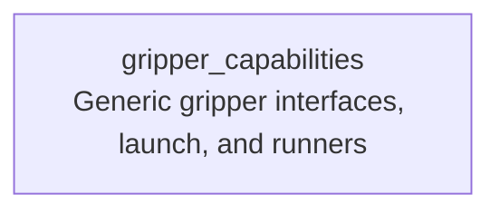

# gripper_capabilities

Provides reusable capabilities2 runners for gripper launch, command, and state access.

## Supported runners

| Runner | Description |
| --- | --- |
| `GripperLaunchRunner` | Starts the reusable soft two-finger gripper stack and waits for `/gripper_command`; robot-specific providers can override its configuration. |
| `GripperCommandRunner` | Sends a `control_msgs/action/GripperCommand` goal with target `position` and optional `max_effort`. |
| `GripperStateRunner` | Reads the current gripper articulation from `/gripper_joint_states` and emits `joint_names` plus `joint_positions` vectors. |

For interface details, see [docs/interface.md](./docs/interface.md).

This package contains reusable runner implementations and generic interfaces/providers only. Robot-specific plans, configuration, and system launches belong in the corresponding robot capability package.

## Capability inheritance



## Build

```bash
cd ~/colcon_ws
colcon build --packages-up-to gripper_capabilities --symlink-install
```
